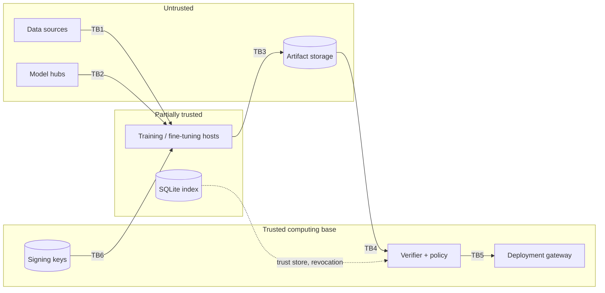

# Threat model — AI-ChainGuard

**Assumption:** the signing keys, the trust store and the verifier code are trusted; everything else (files, storage, pipeline hosts, third-party models, the network) may be hostile. Under this assumption AI-ChainGuard detects tampering **after** attestation; it does not detect malice **before** attestation.

Method: asset-centric analysis with STRIDE classification; each threat is mapped to a verifier check and to the attack scenario that demonstrates it.

## 1. Assets

| Asset | Why it matters |
| --- | --- |
| Datasets and their Merkle roots | Determine model behaviour; prime poisoning target |
| Base and fine-tuned model weights | The deployed behaviour |
| Signed envelopes (manifests) and the provenance graph | The evidence the gateway relies on |
| Private signing keys | **Highest value**: their theft defeats the scheme |
| Trust store and policy file | Decide which signatures count |
| Verifier and gateway code | If replaced, every guarantee collapses |
| Audit trail (verification runs, security events) | Accountability and incident response |

## 2. Actors

| Actor | Capability | Goal |
| --- | --- | --- |
| External attacker | Write access to artifact storage | Modify or swap datasets/models |
| Malicious data contributor (insider) | Adds samples before attestation | Plant a backdoor that gets legitimately signed |
| Compromised training host | Runs code during training; may read the pipeline key | Alter weights, sign rogue models |
| Malicious model publisher | Distributes pretrained models | Ship a backdoored or code-executing model |
| Registry operator | Edits DB or manifests | Hide history, forge status |
| Legitimate signers | Hold role keys | Not malicious, but can be careless |

## 3. Trust boundaries

TB1 data enters · TB2 third-party binaries enter · TB3 code that touched the weights hands over · TB4 bytes at rest may have changed · TB5 last check before production · TB6 keys reach signing processes.

## 4. Entry points and attack surfaces

API (`POST /artifacts`, `/verify`, `/artifacts/{id}/revoke`, `/demo/*`), CLI, files under `data/`, `artifacts/models/`, `artifacts/manifests/`, the SQLite file, `config/policy.yaml`, `keys/`, environment variables (`CHAINGUARD_KEY_*`), CI workflow definitions and secrets, Python dependencies, and model deserialisation.

## 5. Threats, controls and evidence

| # | Threat | STRIDE | AI-specific class | Control | Check | Demonstrated by | Detected? |
| --- | --- | --- | --- | --- | --- | --- | --- |
| T1 | Dataset modified after signing | T | Data poisoning (post) | Hash + row Merkle root, diff localisation | V1, V2 | A1–A4, E1 | Yes |
| T2 | Poisoned data before signing | T | Data poisoning (pre) | Semantic checks, signer accountability | V9 | E2, E3, E4 | Partially (heuristic) |
| T3 | Model file substituted | T, S | Model substitution | Hash bound in signed payload | V1 | B1, B2 | Yes |
| T4 | Malicious serialisation (pickle) | E | Malicious model file | safetensors only; verify before load | V1 + gateway | B3 | Yes |
| T5 | Parent link removed or edited | T | Provenance forgery | Parent digests inside signed payload | V3, V5 | C1, C3 | Yes |
| T6 | History rewritten with a valid key | T | Compromised data steward | Hash links from children | V5 | C2 | Yes (for existing descendants) |
| T7 | Model without dataset ancestry | T | Rogue pipeline | Stage/parent policy | V8 | C4 | Yes |
| T8 | Forged / corrupted / replayed signature | S | — | Ed25519 over canonical payload | V3 | D1, D2, D6 | Yes |
| T9 | Signature by an unknown key | S | Untrusted publisher | Trust store | V3, V4 | D3 | Yes |
| T10 | Key used outside its role | E | Compromised pipeline | Role binding + policy | V4 | D5 | Yes |
| T11 | Use of revoked key/artifact | S | — | Revocation, propagated to descendants | V4, V7 | D4, tests | Yes |
| T12 | Index row deleted to escape revocation | T | — | Missing row = FAILED | V7 | tests | Yes |
| T13 | File swapped between check and use (TOCTOU) | T | — | Read once, hash the read bytes | `open_verified` | tests | Yes |
| T14 | DB status / events edited | R, T | — | Status always recomputed | — | — | Verification yes, audit trail no |
| T15 | Private key theft | S | — | 0600 files, env injection in CI | — | — | **No (residual)** |
| T16 | Compromised builder lies in provenance | T | Malicious training env | Signed claims, role separation | — | — | **No (residual)** |
| T17 | Backdoored third-party base model | T | Untrusted pretrained model | Publisher key, evaluation | V3/V4 + tests | — | Integrity yes, backdoor no |
| T18 | Rollback to an old signed version | T | Model rollback | Revocation of superseded versions | V7 | — | Partially |
| T19 | Unauthenticated API abuse | S, E | — | (prototype: none) | — | — | **No (residual)** |

## 6. Residual risks

1. **Pre-attestation poisoning and backdoors** pass every cryptographic check (E2: 77 % ASR, VERIFIED and deployed). Semantic checks catch only patterns they model (E4: 51 % ASR evades them).
2. **Key compromise** yields perfectly valid signatures. Mitigations: HSM/KMS, short-lived Sigstore certificates, transparency logs, rapid revocation.
3. **Compromised builder**: without TEE attestation or reproducible training, nobody can prove which code produced the weights.
4. **Verifier/trust-store integrity**: the verifier is the trusted computing base; distribute it signed and pin the trust root.
5. **Freshness**: no trusted timestamping; `created_at` is a signer claim.
6. **Prototype API** has no authentication; demo endpoints must be disabled outside demonstrations.

## 7. Why AI supply-chain security differs from software supply-chain security

| Aspect | Software | AI |
| --- | --- | --- |
| Source of behaviour | Readable code | Data + stochastic optimisation |
| Rebuild and compare | Reproducible builds possible | Rarely reproducible bit-for-bit |
| Where malice hides | Lines of code (reviewable) | Statistical property of weights (not reviewable) |
| Typical artifact format | Executables, packages | Weight files, sometimes code-executing (pickle) |
| Upstream dependencies | Libraries | Datasets, pretrained models, fine-tuning services |
| Testing reveals malice? | Often | A backdoored model passes normal accuracy tests |

Integrity can be proven; behaviour can only be tested.
