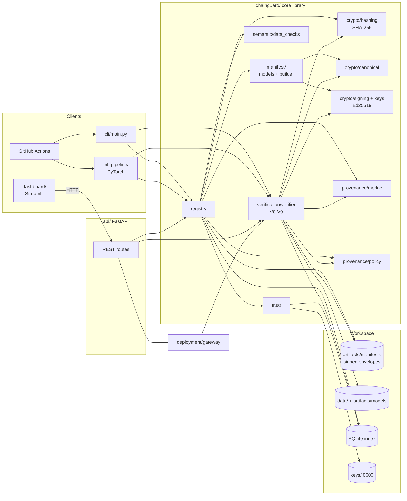
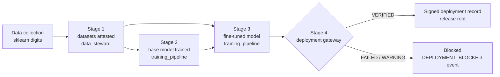
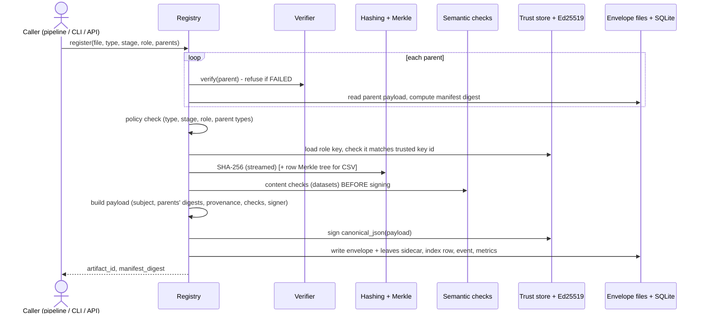
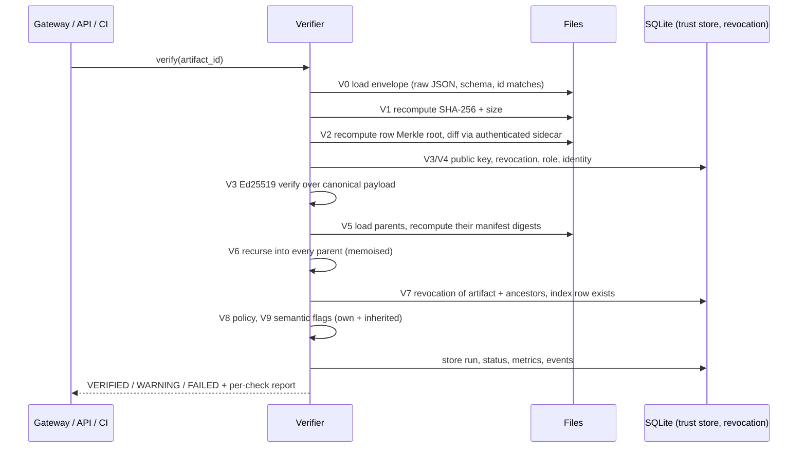
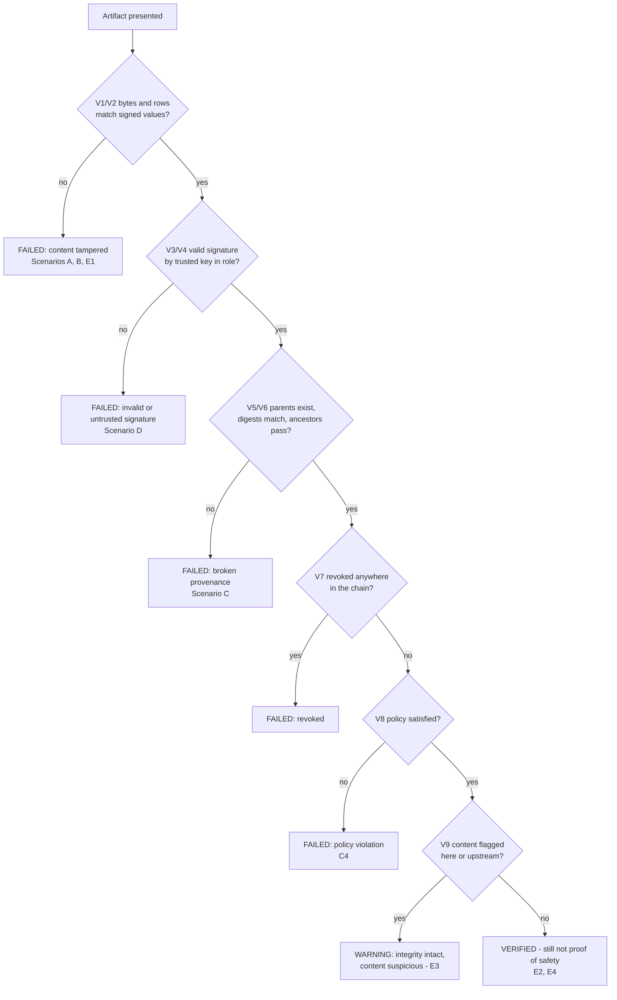
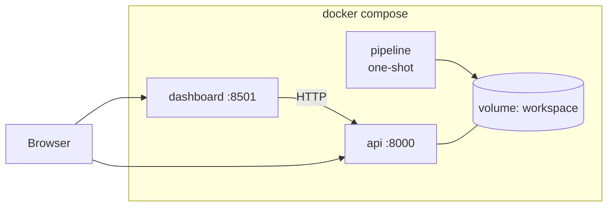

# Architecture

One core library (`chainguard/`) holds all security logic. The CLI, FastAPI backend, ML pipeline, deployment gateway, attack scripts and CI call that same library, so there is exactly one implementation of hashing, signing and verification. The dashboard uses only the HTTP API.

## 1. Overall system architecture

## 2. AI supply-chain lifecycle with attestation points

## 3. Artifact attestation sequence

## 4. Verification sequence

## 5. Attack-detection workflow

## 6. Deployment view

## 7. Key design decisions

| Decision | Alternatives | Reason |
| --- | --- | --- |
| Envelopes on disk are the source of truth; SQLite is an index | DB as truth | CI and auditors can verify from files; DB tampering cannot fake integrity |
| Sign the whole canonical payload | Sign only the file hash | Prevents swapping stage, parents, version, role around a valid hash |
| Parents referenced by manifest digest | By artifact id only | Hash-linking makes history rewrites detectable (C2) |
| Recursive verification at every use | Trust a parent's stored status | Stored status can be edited; recomputation costs a few ms |
| Semantic flags → WARNING only | Fail on any flag | Keeps heuristics from being mistaken for cryptographic proof |
| Role-bound keys + YAML policy | One signing key | Limits blast radius of one key compromise |
